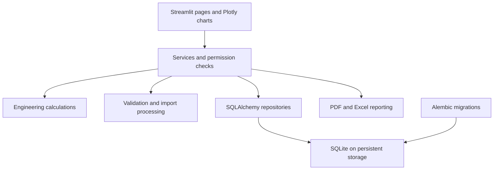
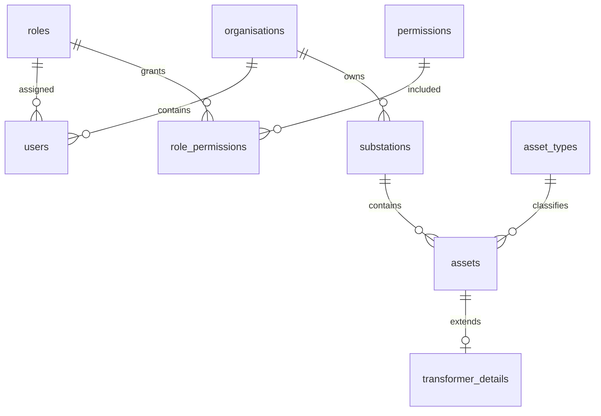
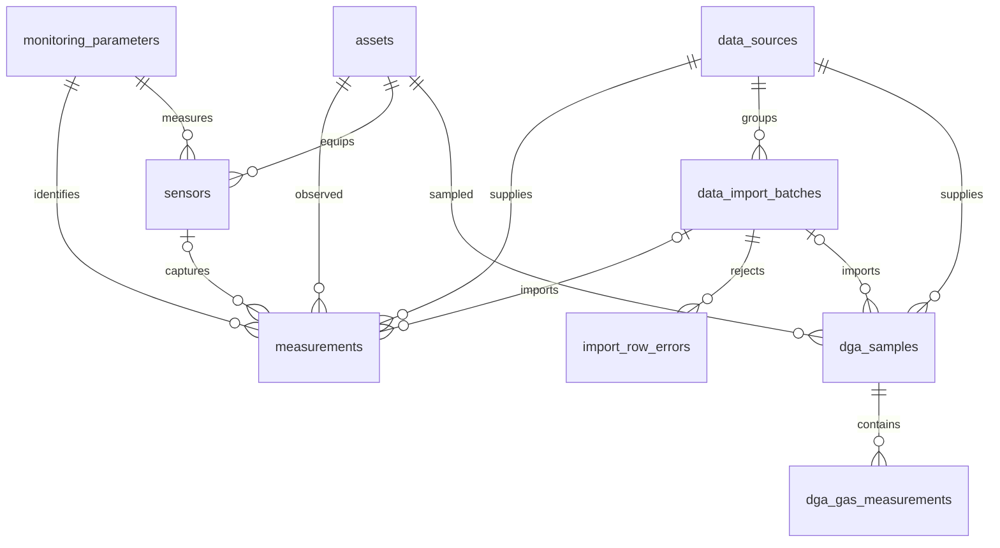
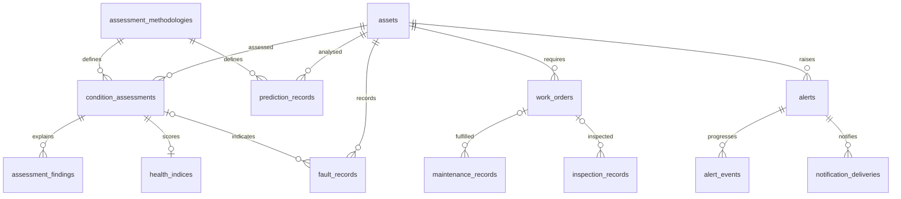

# TECM requirements and database architecture review

Status: proposed for review, 12 November 2026. This is a design deliverable, not an implemented or deployed application.

## 1. Agreed direction and current baseline

The owner has selected Python, Streamlit, SQLite and SQLAlchemy, with a new deployment address outside chatgpt.site. Development remains compatible with Windows and VS Code. Use Python 3.13 for the project environment. Alembic manages database migrations. Pandas, NumPy, Plotly, OpenPyXL, ReportLab and Pydantic support data processing, charts, reporting and validation; scikit-learn is introduced when the predictive milestone is reached.

The inspected GridWatch source uses React/TypeScript, Vinext, Drizzle and Cloudflare D1. It contains four role views, sample asset/condition data, trend displays, evidence review and persistent workflow events. Its workflow API accepts a role supplied by the client; the role selector is not authenticated role-based access control. Its workflow table lacks organisation ownership and actor identity. Do not migrate that role field as proof of user authority.

Reuse its visual organisation, user journeys, evidence concepts and synthetic scenarios. Port the behavior into Python; do not claim the existing TypeScript implementation runs under Streamlit. Existing live records have not been exported or inspected. Preserve the existing site while building and validating the Python version.

## 2. Software requirements specification

### Scope and actors

Transformers receive full first-version support, including oil-immersed and dry-type construction and power/distribution application. Other electrical equipment can be registered, but must show unsupported analytics explicitly. Organisations own their users, substations, assets and operational data. Proposed roles are platform administrator, organisation administrator, electrical engineer, maintenance engineer, technician and viewer. Operations remains a task-oriented dashboard view; permissions come from the authenticated account, not a view selector.

| ID | Functional requirement | Acceptance evidence |
|---|---|---|
| F01 | Login, logout, password hashing, controlled account registration and deactivation | Invalid credentials fail; inactive users cannot read records; logout clears authentication state |
| F02 | Organisation administration with isolated operational data | A user in organisation A cannot read, export or modify organisation B records, including by submitting its identifiers |
| F03 | Create/edit/deactivate substations and assets with transformer details | Codes are unique within the organisation; invalid cross-organisation links fail |
| F04 | Manual readings with timestamp, parameter, unit, source and quality | Non-finite values and inappropriate units are rejected; observed and recorded times survive round trips |
| F05 | CSV/XLSX preview, validation, duplicate checks, rejected-row export and explicit import confirmation | Preview writes no measurements; confirmed accepted rows and import counts reconcile; retry creates no duplicates |
| F06 | Configurable simulation with normal and abnormal scenarios | All generated readings are marked simulated; history remains queryable after restart |
| F07 | Historical monitoring and asset comparisons with Plotly | Selected asset, organisation and time window govern all plots and exports |
| F08 | DGA sample capture for seven gases and evidence-based interpretation | Missing/qualified concentrations and zero denominators handled; no standard method is enabled without versioned criteria and reference tests |
| F09 | Thermal, oil and insulation assessments | Applicable criteria, test conditions, inputs, limitations and calculation versions recorded |
| F10 | Explainable health index | Weights, component contributions, completeness and methodology reproducible from saved evidence |
| F11 | Fault indications and confirmed-fault workflow | Algorithm results default to indications; confirmation requires an authorised engineer and supporting evidence |
| F12 | Historical regression, rate of change and anomaly analysis | Outputs show data window, model version and validation limits; no unsupported failure probabilities |
| F13 | Work orders, maintenance findings and inspection history | Assignment validated within the organisation; completion records retained and linked |
| F14 | Alerts, acknowledgement, resolution and evaluation feedback | Actor, time, evidence and transitions stored; duplicate acknowledgements prevented |
| F15 | PDF/XLSX reports at asset, station and organisation scope | Tenant-filtered results, units, provenance, methods and report generation metadata included |
| F16 | Email notifications | Explicit recipient configuration, retry status and auditability; sending remains disabled until configured and authorised |

### Quality and engineering requirements

Server-side service functions enforce permissions on every read and mutation, including downloads. UI visibility alone is insufficient. SQLAlchemy sessions are short-lived and transactions include related audit events. No globally cached tenant data or session objects. Cache keys, where used, must include organisation and relevant user scope.

Use UTC internally and display Africa/Nairobi time with timezone labels. Require an explicit timezone during import. Reject NaN and infinite values. Keep missing values distinct from zero and not applicable. Dry-type transformers must reject oil-specific observations and omit oil/DGA from applicable health-index components.

Store raw unit/provenance and a canonical value/unit. Conversions must be explicit and tested. Validate engineering ranges using configured criteria, not hardcoded universal thresholds. A breach is an abnormal-condition indication, not a diagnosis.

Engineering method definitions include source, edition, applicability, effective dates and revision. Standard-specific methods need authoritative criteria and independently checked examples before activation. No invented IEC/IEEE thresholds. Demonstration criteria remain clearly marked and cannot be silently used for field assessments.

Performance targets for initial verification, not measured results: dashboard interaction within two seconds for a representative 100,000-reading test database on documented hardware; transactional imports in bounded chunks; responsive forms usable at 375 px width. Benchmark and revise the limits using actual deployment evidence.

## 3. Modular architecture

Engineering functions accept validated data structures and return structured results without importing Streamlit or accessing its session state. Repositories handle persistence, services establish tenant/actor context and enforce workflows, and the UI handles presentation. Separate simulation, import and notification adapters allow future integrations without changing engineering calculations.

Authentication proposal: Argon2id password hashes, administrator-controlled organisation assignment, login throttling, idle expiry and rechecking active status on protected actions. Registration can create a pending account but must never grant a user a self-selected privileged role. Bootstrap the first administrator from a one-time local command using a prompted secret; do not ship default passwords. Final authentication implementation requires security testing before hosting.

## 4. Proposed physical schema and data dictionary

This expands the handover's 26 entities to 33. Preserve the original entities; add seven for limits, reproducible methods, import errors, alert events, inspections, relay events and delivery tracking. These additions are proposals, not approvals already received.

Conventions: every table has `id TEXT PRIMARY KEY` containing a UUID except role_permissions, whose composite primary key is stated below. Every table includes `created_at DATETIME NOT NULL` in UTC. Mutable tables also have `updated_at DATETIME NOT NULL`. `T` means text, `R` real, `I` integer, `B` boolean stored as a constrained 0/1 integer, `DT` UTC datetime, `D` date, `J` validated JSON. `?` means nullable; all other listed attributes are required unless a default is specified. Foreign keys are explicitly named in the relationship section. A JSON field holds versioned calculation evidence or structured metadata, not the core asset/measurement model.

All organisation-owned tables have `organisation_id T` and a unique `(organisation_id,id)` key. Tenant-qualified foreign keys reference those pairs. Historical rows use restricted deletion. Operational entities use `is_active B=true` or lifecycle status. Global catalogue entries have no organisation ownership; global catalogues are writable only by platform administrators.

| Entity | Attributes beyond common fields | Purpose and principal constraints |
|---|---|---|
| organisations | code T, name T, industry T?, country T, address T?, contact_email T?, contact_phone T?, is_active B=true | Tenant root; unique normalised code |
| users | organisation_id T?, role_id T, email T, display_name T, password_hash T, is_active B=true, is_platform_admin B=false, failed_attempts I=0, locked_until DT?, last_login_at DT? | Unique normalised email; organisation required unless platform administrator; platform status and assigned role must agree through service validation |
| roles | code T, name T, description T? | Global role catalogue; unique code |
| permissions | code T, description T | Global permission catalogue; unique code |
| role_permissions | role_id T, permission_id T | Composite PK (role_id,permission_id); no separate UUID |
| substations | organisation_id T, code T, name T, location T, latitude R?, longitude R?, voltage_kv R?, description T?, status T, is_active B=true | Unique (organisation_id,code); valid coordinates and positive voltage when supplied |
| asset_types | code T, name T, description T?, analytics_supported B=false, is_active B=true | Global catalogue; unique code; generic Transformer category |
| assets | organisation_id T, substation_id T, asset_type_id T, code T, name T, manufacturer T?, model T?, serial_number T?, manufactured_year I?, installed_on D?, commissioned_on D?, status T, criticality T, is_active B=true | Unique (organisation_id,code); no global uniqueness assumption for manufacturer serial numbers |
| transformer_details | organisation_id T, asset_id T, application T, construction T, rating_kva R, primary_kv R, secondary_kv R, phases I, frequency_hz R, vector_group T?, cooling T?, insulation_class T?, impedance_percent R?, tap_changer_type T?, rated_primary_a R?, rated_secondary_a R?, oil_volume_l R? | Unique asset_id; positive ratings; phases 1 or 3; application power/distribution; construction oil/dry; oil volume absent for dry type; transformer asset-type check in service and tests |
| monitoring_parameters | code T, name T, canonical_unit T, category T, applicability T, is_active B=true | Unique code; applicability transformer_all/oil_only/dry_only/general; explicit catalogue policy for other equipment |
| data_sources | organisation_id T, code T, name T, source_type T, description T?, is_active B=true | Unique tenant/code; source type manual/csv/excel/sensor/scada/simulation |
| data_import_batches | organisation_id T, source_id T, uploaded_by T, filename T, file_sha256 T, stored_path T?, status T, total_rows I=0, accepted_rows I=0, rejected_rows I=0, duplicate_rows I=0, mapping_snapshot J, confirmed_at DT? | Nonnegative counts; status preview/validated/importing/completed/failed; idempotency enforced for confirmed content and mapping |
| sensors | organisation_id T, asset_id T, parameter_id T, code T, manufacturer T?, model T?, serial_number T?, protocol T?, installed_at DT?, communication_status T, is_active B=true | Unique tenant/code; parameter assignment explicit |
| measurements | organisation_id T, asset_id T, parameter_id T, source_id T, sensor_id T?, batch_id T?, recorded_by T?, observed_at DT, recorded_at DT, value R, unit T, raw_value R, raw_unit T, quality T, is_simulated B=false, external_record_id T?, dedupe_key T, supersedes_id T? | Unique tenant/dedupe_key; append-oriented corrections; normalised unit must match parameter; finite value checked before database write |
| dga_samples | organisation_id T, asset_id T, source_id T, batch_id T?, recorded_by T?, sample_reference T, sampled_at DT, laboratory T?, method T?, notes T?, is_simulated B=false | Unique tenant/asset/sample_reference; oil transformers only; repeated sampling remains separate from result corrections |
| dga_gas_measurements | organisation_id T, sample_id T, gas_code T, concentration_ppm R?, qualifier T, detection_limit_ppm R?, quality T | Unique sample/gas; gas restricted to H2,CH4,C2H6,C2H4,C2H2,CO,CO2; nonnegative concentrations; qualifier measured/below_limit/not_measured; below-limit result is not silently zero |
| condition_assessments | organisation_id T, asset_id T, methodology_id T, sample_id T?, assessment_type T, assessed_at DT, assessed_by T?, result_status T, evidence_snapshot J, limitations T?, recommendations T? | Evidence references measurement/test IDs and captures values/units used; simulation provenance included |
| assessment_findings | organisation_id T, assessment_id T, category T, severity T, statement T, evidence_snapshot J, recommended_action T? | Multiple findings per assessment; severity information/warning/critical |
| health_indices | organisation_id T, asset_id T, assessment_id T, methodology_id T, calculated_at DT, score R?, classification T, completeness R, confidence_label T, calculation_snapshot J | Unique assessment_id; score/completeness within 0–100; null score for insufficient data; snapshot includes components, weights, contributions, coverage, inputs, excluded components and revision |
| fault_records | organisation_id T, asset_id T, assessment_id T?, category T, severity T, status T, detected_at DT, detection_method T, evidence_snapshot J, recommended_action T?, confirmed_by T?, confirmed_at DT?, resolved_at DT?, resolution_note T? | indication/confirmed/ruled_out/resolved; confirmation requires engineer and evidence; no automatic promotion to confirmed |
| prediction_records | organisation_id T, asset_id T, parameter_id T?, methodology_id T, analysis_type T, window_start DT, window_end DT, generated_at DT, horizon_hours R?, output_snapshot J, limitations T, is_simulated B=false | Trend/anomaly classification; output includes model version, training/data provenance, fit metrics and units; failure probability disabled pending validation |
| maintenance_records | organisation_id T, asset_id T, work_order_id T?, performed_by T?, performed_at DT, activity_type T, findings T, actions_taken T, replaced_components T?, next_due_on D?, source_reference T? | Performed work remains historical; user or documented external performer required by service |
| work_orders | organisation_id T, asset_id T, code T, title T, description T, priority T, status T, assigned_to T?, created_by T, due_on D?, started_at DT?, completed_at DT?, cancelled_at DT?, cancellation_reason T? | Unique tenant/code; Open/Assigned/In Progress/Completed/Cancelled; completion requires linked maintenance record |
| alerts | organisation_id T, asset_id T, assessment_id T?, fault_id T?, work_order_id T?, severity T, title T, message T, evidence_snapshot J, rule_revision T, dedupe_key T, triggered_at DT, status T, acknowledged_by T?, acknowledged_at DT?, resolved_by T?, resolved_at DT? | Status open/acknowledged/resolved; unique tenant/dedupe_key; current state is updated transactionally with append-only alert events |
| reports | organisation_id T, asset_id T?, substation_id T?, created_by T, report_type T, format T, period_start DT?, period_end DT?, status T, file_path T?, file_sha256 T?, scope_snapshot J, generated_at DT? | PDF/XLSX; storage paths not exposed without permission checks; snapshot pins included evidence and method revisions |
| audit_logs | organisation_id T?, actor_id T?, action T, entity_type T, entity_id T?, occurred_at DT, details J, request_id T? | Append-only; null organisation only for platform/system events; no passwords or secrets in details |
| parameter_limits | organisation_id T, parameter_id T, asset_type_id T?, asset_id T?, regime T, applicability T, warning_low R?, warning_high R?, critical_low R?, critical_high R?, unit T, source T, source_edition T?, revision T, effective_from DT, effective_to DT?, approved_by T, is_demo B=false | New; at least one bound; validate ordered bounds and no conflicting effective ranges at same scope; asset overrides type, then organisation default; ambiguity fails closed |
| assessment_methodologies | code T, version T, assessment_type T, description T, source T, source_edition T?, configuration J, validation_status T, effective_from DT, effective_to DT? | New global immutable version catalogue; unique code/version; status draft/validated/retired; never alter a version used by an assessment |
| import_row_errors | organisation_id T, batch_id T, row_number I, column_name T?, error_code T, message T, raw_row J | New; one row may have multiple errors; redact unexpected sensitive input; row number >0 |
| alert_events | organisation_id T, alert_id T, actor_id T, event_type T, occurred_at DT, note T?, outcome T?, clarity_rating I?, idempotency_key T | New; acknowledge/verify/handoff/finding/resolve/reopen/evaluate; rating 1–5; unique tenant/idempotency_key; actual actor always captured |
| inspection_records | organisation_id T, asset_id T, work_order_id T?, inspector_id T?, inspected_at DT, inspection_type T, findings T, checklist_snapshot J, recommendations T?, external_reference T? | New; keeps structured checklist evidence apart from time-series readings and maintenance actions |
| relay_events | organisation_id T, asset_id T, source_id T, batch_id T?, occurred_at DT, recorded_at DT, protection_function T, event_type T, breaker_state T?, phase T?, value R?, unit T?, evidence_snapshot J, external_record_id T?, is_simulated B=false | New; asset identifies relay/breaker being monitored; no claim of live integration; preserve event-time precision |
| notification_deliveries | organisation_id T, alert_id T, recipient_user_id T, channel T, status T, attempts I=0, last_attempt_at DT?, sent_at DT?, error_summary T?, idempotency_key T | New; pending/sent/failed/cancelled; unique tenant/idempotency_key; no email secret in records |

### Keys, indexes and validation

1. `PRAGMA foreign_keys=ON` on every connection; configure busy timeout and WAL after verifying target filesystem compatibility. One application instance and short write transactions initially. Do not place SQLite on a shared network filesystem.
2. Organisation-owned references use composite foreign keys `(organisation_id,foreign_id)` to `(organisation_id,id)`. Global catalogues use simple foreign keys. User references require matching organisation except deliberately audited platform actions, which use explicit administrative service paths rather than weakening tenant constraints.
3. Measurements index `(organisation_id,asset_id,parameter_id,observed_at)` and `(organisation_id,batch_id)`; samples index `(organisation_id,asset_id,sampled_at)`; alerts index `(organisation_id,status,severity,triggered_at)`; work orders index `(organisation_id,status,due_on)`; audit index `(organisation_id,occurred_at)`; relay events index `(organisation_id,asset_id,occurred_at)`.
4. Additional composite reference constraints ensure a sensor belongs to the measurement asset and parameter, and a batch belongs to the measurement source. For DGA, assessment and health records, validate matching asset/sample/assessment relationships before commit and add composite keys where expressible. Every such invariant receives a negative test.
5. Check constraints cover enum values, nonnegative counters and concentrations, valid score ranges and date order. Finite-number checks, catalogue applicability, strict JSON structure, overlapping threshold periods and transformer subtype rules are service validation responsibilities unless a portable database constraint exists.
6. Derive measurement duplicate keys from organisation, asset, parameter, normalised observation time and source record identity or canonical payload. Deliberate corrections reference supersedes_id; never silently discard conflicting values as duplicates. Preview identifies identical versus conflicting rows separately.
7. Upload batches reconcile total = accepted + rejected + duplicates when completed. Multiple error records do not increase the rejected-row count. Confirmed import writes and batch status updates are transactional; chunked imports explicitly record chunk progress and can resume idempotently.
8. Do not cascade-delete engineering history. Deactivate assets/users/catalogues. Backup before migrations; Alembic creates and updates the physical schema, not application startup create_all.

## 5. Relationships and ERD

### Identity and inventory

### Acquisition

### Assessment and operations

Other required cardinalities: each organisation owns zero or more records in each tenant table; each asset has zero or more limits, relay events, reports, inspections, maintenance records and predictions. Each monitoring parameter has zero or more limits. A limit optionally targets one asset or asset type. Each assessment optionally references one DGA sample; a sample may support many assessments. A methodology has many health-index records. An alert optionally references one assessment, fault and/or work order; each may produce many alerts. A report optionally targets one asset or one substation; neither means an organisation-wide report. Users have many created batches, observations, events, reports and assigned work orders. Audit entity IDs are polymorphic references, deliberately not a database foreign key; validate them through services.

## 6. Proposed Python folder structure

| Path | Responsibility |
|---|---|
| app.py | Entry point, authentication gate, navigation and shared page layout |
| config/settings.py | Environment configuration, timezone and database location |
| database/connection.py | Engine, connection pragmas and session factory |
| database/models/ | Identity, inventory, acquisition, engineering and operations model modules |
| database/repositories/ | Tenant-scoped SQLAlchemy queries and persistence |
| database/migrations/ | Alembic environment and reviewed version scripts |
| modules/authentication/ | Password verification, session checks, permissions and bootstrap |
| modules/organisations/ | Organisation and substation services |
| modules/assets/ | Asset/transformer schemas, validation and services |
| modules/data_acquisition/ | Manual entry, import preview/commit, duplicate handling and simulation |
| modules/monitoring/ | Time-window queries, summary metrics and provenance |
| modules/intelligence/ | DGA, thermal, oil, insulation, health-index and rule engines |
| modules/predictive/ | Trend, regression and anomaly functions and model validation |
| modules/maintenance/ | Work orders, inspections, relay evidence and maintenance history |
| modules/alerts/ | State transitions, evidence, feedback and notification adapters |
| modules/reports/ | PDF/XLSX generation and scope validation |
| dashboard/ | Streamlit page modules and reusable Plotly components |
| data/sample_data/ | Clearly labelled synthetic CSV/XLSX fixtures |
| data/uploads/ | Local development uploads; hosted path configured on persistent storage |
| tests/ | Unit, tenant-isolation, import, engineering, workflow and UI tests |
| docs/ | Requirements, architecture, ERD, decision log and validation evidence |
| requirements.txt | Tested pinned dependencies when implementation begins |
| .env.example | Variable names and non-secret examples only |
| .gitignore | Exclude secrets, environments, live databases and private uploads |
| README.md | Windows setup, running, testing, migrations, backup and deployment instructions |

## 7. Phased delivery and validation

| Milestone | Working deliverable | Exit checks |
|---|---|---|
| 1 Foundation | Reviewed schema, Alembic migration, reference seeds, authentication, permissions | Constraints and cross-tenant negative tests; no default passwords; repeat migrations safe |
| 2 Asset management | Organisation, substation and transformer forms plus viewer pages | Duplicate codes, inactive accounts and subtype validation tested |
| 3 Acquisition | Manual readings, CSV/XLSX preview/commit, rejected rows and simulation | Import retry, timezone/unit errors, missing values and provenance tests |
| 4 Monitoring | Four task views, asset selection, trends, data coverage and evidence history | Correct scope on charts, downloads and every detail view; restart persistence test |
| 5 Engineering | Validated configured thermal/insulation/oil methods, DGA methods and explainable health index | Reference examples, zero ratios, below-detection limits, dry applicability and missing-data tests |
| 6 Prediction | Trends, rate of change, regression and anomaly analysis | No look-ahead leakage; validation dataset and limitations documented |
| 7 Maintenance and reporting | Orders, inspection/maintenance entries, alerts, feedback and reports | Workflow permissions, timestamps, report scope and reconciliation tests |
| 8 Hosted acceptance | Authenticated deployment outside chatgpt.site with persistent SQLite | Unauthenticated access blocked, tenant isolation, backup/restore, restart persistence, browser and supervisor acceptance tests |

Ship and test increments, not a single unreviewed application. Email delivery and unsupported diagnostic methods remain disabled until their configuration and validation are complete. A test plan is not evidence of passing tests: this document reports no implementation tests as executed.

### Existing work migration

Keep the existing live site available. Preserve sample identifiers as external references in labelled synthetic fixtures. Export real workflow events only after verifying export access and backup. Existing event roles do not identify authenticated people: import them with explicit legacy/unknown actor provenance, not invented users. Reconcile record counts and have the owner verify the transferred history before considering any retirement of the old site. No live migration has occurred.

## 8. Deployment and review decisions

Proposed host: Render Python web service with a paid persistent disk and one application instance. A provider-assigned onrender.com address or an owner-controlled custom domain meets the new URL requirement; exact name and availability are not yet reserved. Streamlit binds to the host-supplied port. SQLite and uploads must reside on the mounted disk. Use database-consistent backups, store a separate backup copy and verify restoration. A new deployment must not initialise over an existing database.

The service URL would be internet-reachable, but all TECM pages and data require login and server-side authorisation. This is application-private access, not a private network service. If the owner requires network-private access, choose a VPN/access gateway arrangement before deployment. Keep source private and secrets in provider configuration. Do not expose database or upload directories as static files.

Render requires a paid service for a persistent disk. Do not provision paid resources without an agreed plan and cost. Render connection is needed for assisted deployment. No hosting resources have been created and no new working URL exists yet.

Streamlit Community Cloud is not selected for durable local SQLite storage because its documentation does not guarantee local filesystem persistence. This does not affect the chosen Streamlit framework.

Official hosting references, checked 12 November 2026:
- https://render.com/docs/web-services
- https://render.com/docs/disks
- https://docs.streamlit.io/develop/concepts/connections/connecting-to-data

### Decisions requiring owner review before model implementation

1. One organisation and one role per user initially, with a separate platform administrator account. If consultants must act in multiple organisations, replace this assumption with explicit memberships before the migration is written.
2. The 33-table schema and seven additions described above.
3. Versioned JSON health-index evidence, with normalised measurements/findings and immutable methodology versions.
4. Administrator-controlled onboarding and authenticated, application-private browser access.

Host connection, final paid plan approval, domain name and deployment are later operational decisions; they do not block review of this schema. Approved stack and new non-chatgpt.site URL are already recorded and do not require reconfirmation.
